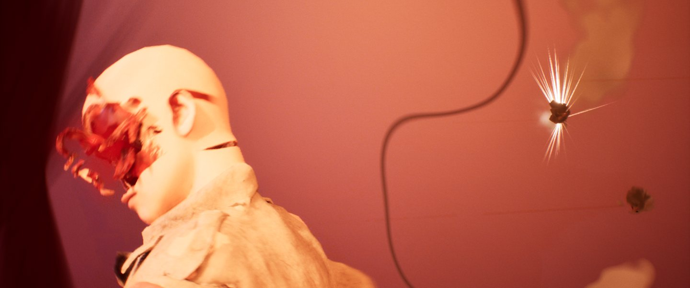

# Burned Lines

**Status:** In development  
**Engine:** Unreal Engine 5  
**Genre:** Survival FPS

A dark, gritty first-person survival shooter. Fight through a collapsing facility with limited stamina and a flashlight, while fire, falling ceilings and sparking wires are as dangerous as the enemies.

## Features in progress

- Sprint and stamina, flashlight, lean and cover
- Environmental hazards: fire, collapsing floors, falling ceilings
- Detailed damage system on enemies

## Follow the project

- Portfolio: https://mayank2314-23432.github.io/global-user.mayank/

---

This repository is a showcase page. The game's source and assets are kept private while it is in development.
