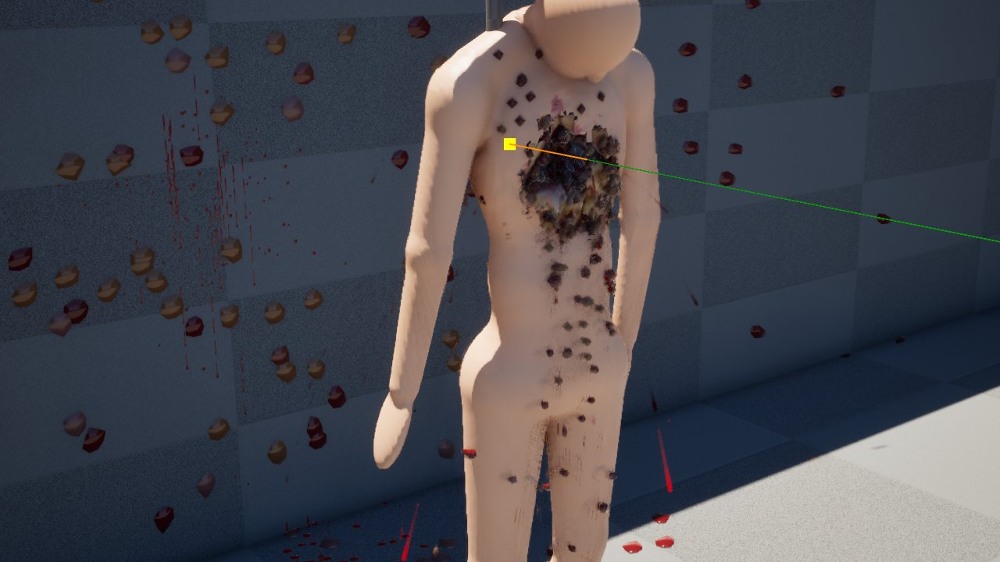

# TeatherLab

**Status:** In development  
**Engine:** Unreal Engine 5  
**Genre:** Physics sandbox

A first-person physics lab built around a custom soft-body damage system: targets deform, tear and break apart realistically under different weapons.

## Features in progress

- Custom soft-body damage plugin with layered tissue
- Different weapons produce different damage
- Persistent fragments and fluid effects

## Follow the project

- Discord: https://discord.gg/dgrTyX7hv
- Portfolio: https://mayank2314-23432.github.io/global-user.mayank/

---

This repository is a showcase page. The game's source and assets are kept private while it is in development.
